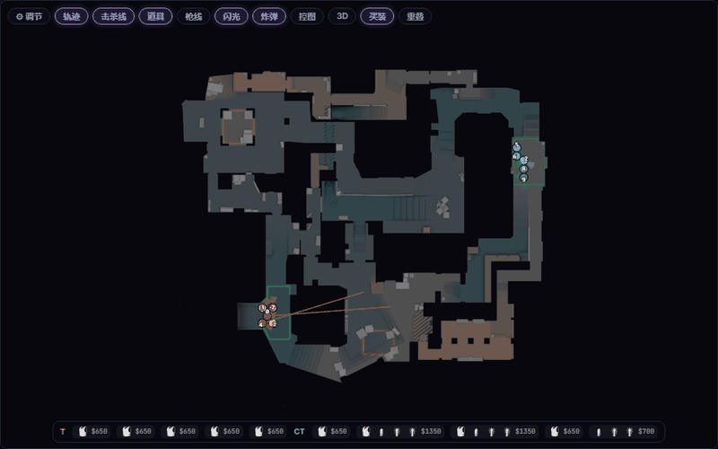
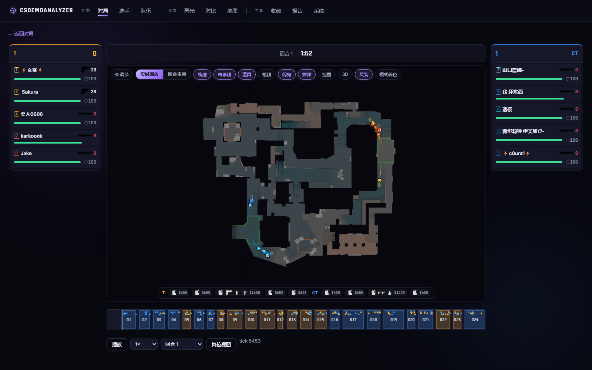
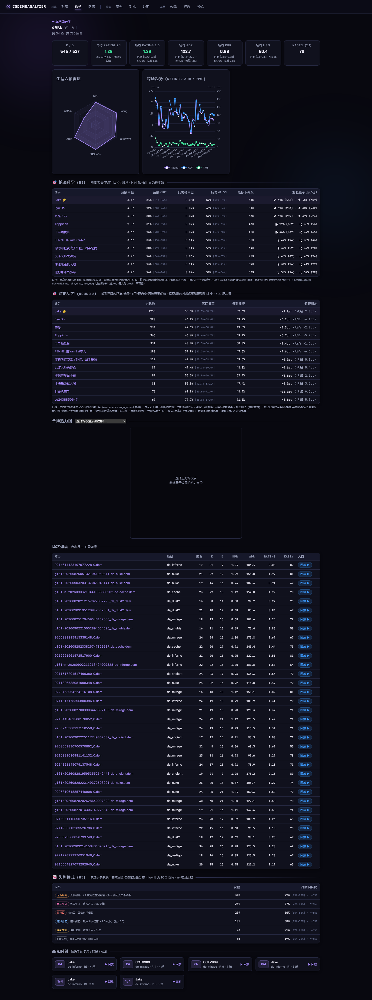
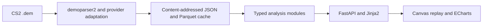

# CS Demo Analyzer

**Turn CS2 demo files into an interactive local review desk.** Quantitative match analysis, a 2D replay viewer, round overlays and cross-match player comparisons run in your browser.

[简体中文](README.zh-CN.md) · [Architecture](ARCHITECTURE.md) · [Metric definitions](docs/funlab-metrics.md) · [History](docs/README-history.md)



*Existing public application recording; replay data is visualized from a demo, not a live game feed. The installed interface currently uses Chinese labels.*

## What you can investigate

| View | Questions it helps answer |
|---|---|
| Match and economy | What happened in each round? Which buys, duels and utility events mattered? |
| Replay and round overlap | How did positions, routes and engagements change over time? |
| Career and comparison | How does a player's per-round performance compare across the available sample? |
| Reports and library | Which rounds deserve review? How do imported matches and saved notes connect? |

| Replay viewer | Player career |
|---|---|
|  |  |

## Quick start

Python **3.11+** is required. No server-side video rendering or ffmpeg is needed for the browser replay.

```bash
python -m pip install -e .
csa serve
```

Open `http://127.0.0.1:8000`, then upload a `.dem` file. Windows users can use `start_web.bat`, `start_web.bat restart` and `stop_web.bat`.

```bash
csa info path/to/demo.dem
csa parse path/to/demo.dem
csa analyze path/to/demo.dem
csa coverage "demos/*.dem" --out report.html
```

Core analysis uses local demos and caches. Optional professional-baseline retrieval needs internet access and is separate from the local workflow.

## How it works



The analysis modules cover basic statistics, rating approximations, duels, economy, utility, routes, post-plant situations and weapon context. Definitions and sample thresholds matter: model-based ratings and win probabilities are estimates rather than official Valve/HLTV measurements or causal explanations. See [architecture](ARCHITECTURE.md), [metric definitions](docs/funlab-metrics.md) and [research ledger](docs/research-ledger.md).

## Status and limitations

The public source contains the review platform and existing recordings shown above. Demo-provider event coverage varies; missing pawn positions can exclude a player from spatial analysis even when kill statistics remain available. Small libraries limit comparison and model reliability. Historical test totals and timings are retained in [HANDOFF](HANDOFF.md), not presented as a fresh benchmark here.

For development, install the existing dev extra and run `python -m pytest`; this README pass checks documentation and asset references only. It does not import private demos or rerun the application.

## License and credits

Package metadata declares MIT for the project source; see [pyproject.toml](pyproject.toml). demoparser2, ECharts and bundled map/weapon assets retain their respective upstream terms. This is an independent CS2 analysis project, not an official Valve product.
