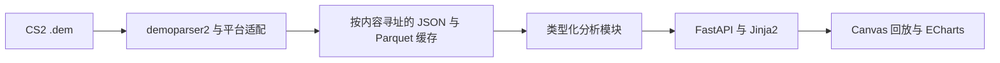

# CS Demo Analyzer

**把 CS2 录像变成本地交互复盘台。** 在浏览器中查看对局定量统计、2D 回放、回合重叠和跨场选手对比。

[English](README.md) · [架构](ARCHITECTURE.md) · [指标定义](docs/funlab-metrics.md) · [历史](docs/README-history.md)


*仓库原有公开应用实录，展示从 demo 还原的数据，不是实时游戏画面输入；当前安装界面为中文。*

## 可以研究什么

| 视图 | 帮助回答的问题 |
|---|---|
| 对局与经济 | 每回合发生了什么？购买、对枪与道具有何影响？ |
| 回放与回合重叠 | 站位、路线和交战怎样随时间变化？ |
| 生涯与对比 | 选手的每回合表现如何随场次变化，与现有样本怎样比较？ |
| 报告与录像库 | 哪些回合值得重看？导入对局如何关联收藏与笔记？ |

| 回放器 | 选手生涯 |
|---|---|
|  |  |

## 快速开始

需要 Python **3.11+**。浏览器回放不需要服务端视频渲染或 ffmpeg。

```bash
python -m pip install -e .
csa serve
```

打开 `http://127.0.0.1:8000`，上传 `.dem` 文件。Windows 用户也可使用 `start_web.bat`、`start_web.bat restart` 和 `stop_web.bat`。

```bash
csa info path/to/demo.dem
csa parse path/to/demo.dem
csa analyze path/to/demo.dem
csa coverage "demos/*.dem" --out report.html
```

核心分析使用本地录像与缓存；可选职业基准抓取需要联网，与本地复盘流程分开。

## 工作流程



模块包括基础统计、评分近似、对枪、经济、道具、路线、下包攻防和武器情境。指标定义与样本门槛影响解释：模型评分及胜率是估计，不是 Valve／HLTV 官方测量或因果结论。详见 [架构](ARCHITECTURE.md)、[指标定义](docs/funlab-metrics.md) 和 [研究台账](docs/research-ledger.md)。

## 状态与限制

公开源码包含上述复盘平台与现有实录。不同平台 demo 的事件覆盖不同；个别玩家位置缺失时，空间分析会跳过该玩家，击杀统计可能仍然可用。小样本录像库限制对比和模型可信度。历史测试数及耗时保留在 [HANDOFF](HANDOFF.md)，这里不把它们当作新跑的基准结果。

开发时可安装已有 dev extra，运行 `python -m pytest`。本次只核验文档和资源引用，没有导入私有录像或重跑应用。

## 许可与致谢

项目包元数据声明源码使用 MIT，见 [pyproject.toml](pyproject.toml)。demoparser2、ECharts、地图和武器素材继续适用各自上游条款。本项目独立开发，不是 Valve 官方产品。
